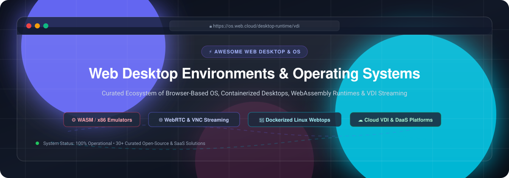

# 🖥️ Awesome Web Desktop Environments & Operating Systems 🌐

  

  
  
  
  
  
  
  

---

## 📖 Curated Directory of Web Desktop Environments, WebOS & Cloud VDI 🚀

Welcome to the definitive, curated index of **Web Desktop Environments**, **Browser-Based Operating Systems (WebOS)**, **Containerized Remote Desktops**, and **Cloud Virtual Desktop Infrastructure (VDI / DaaS)**. 

Whether you need low-latency browser streaming via WebRTC/VNC/RDP, client-side WebAssembly x86 PC emulation, modular JavaScript desktop window managers, or enterprise cloud DaaS solutions, this directory covers both battle-tested commercial SaaS platforms and high-performance open-source GitHub repositories.

---

## 📑 Table of Contents 📌

- [📊 Sector Overview & Market Dynamics](#-sector-overview--market-dynamics)
- [☁️ SaaS & Hosted Cloud Desktop Platforms](#️-saas--hosted-cloud-desktop-platforms)
- [💻 Open-Source GitHub Projects](#-open-source-github-projects)
- [📈 Star History](#-star-history)
- [💖 Support & Sponsorship](#-support--sponsorship)
- [🤝 How to Contribute](#-how-to-contribute)
- [⚖️ Disclaimer](#️-disclaimer)

---

## 📊 Sector Overview & Market Dynamics 📈

The global Virtual Desktop Infrastructure (VDI) and Desktop-as-a-Service (DaaS) market is valued at approximately **$18.5 Billion to $24 Billion (2024–2026)** and is projected to expand at a compound annual growth rate (CAGR) exceeding **18% to over $60 Billion by 2032**. 

The sector displays a **moderately concentrated, bifurcated market structure**:
- **Enterprise Core (Concentrated)**: Megacap hyperscalers (Microsoft with Windows 365 / Azure Virtual Desktop, Amazon with AWS WorkSpaces, and Google Cloud Workstations) dominate standard enterprise workforce deployments due to deep enterprise identity, active directory, and productivity bundling advantages.
- **Specialized Streaming & Open-Source Tier (Highly Fragmented)**: Fast-growing innovator ecosystems thrive around low-latency WebRTC streaming, disposable containerized browser isolation (Kasm Workspaces), GPU rendering/AI workstations (DigitalOcean Paperspace), and pure client-side WebAssembly runtimes (Puter, WebVM, daedalOS, v86).

---

## ☁️ SaaS & Hosted Cloud Desktop Platforms 🏢

*Ranked in descending order by parent company market capitalization and estimated enterprise scale.*

| Product Name 🖥️ | Provider / Company 🏢 | Scale (Revenue / Valuation) 💰 | Starting Price Tier 💵 | Free Tier / Trial Limit ⏱️ | Key Capabilities & Highlights 🔍 |
| :--- | :--- | :--- | :--- | :--- | :--- |
| **[Windows 365](https://www.microsoft.com/en-us/windows-365)** | Microsoft | $3.1 Trillion Market Cap (~$245B Ann. Rev) | $28.00/user/month (Business 2 vCPU / 4GB RAM / 64GB SSD) | 30-day free trial (up to 3 licenses of Windows 365 Business 2 vCPU / 8GB RAM / 128GB) | Persistent, dedicated Cloud PC streaming personalized Windows 11 directly into modern HTML5 web browsers. |
| **[Azure Virtual Desktop](https://azure.microsoft.com/en-us/products/virtual-desktop)** | Microsoft | $3.1 Trillion Market Cap (~$245B Ann. Rev) | $5.40/user/month (pooled multi-session compute + Azure consumption) | $200 free Azure credits for 30 days + 12 months access to popular free services | Scalable enterprise multi-session Windows 11 and Windows 10 deployment with native Microsoft 365 optimization. |
| **[Google Cloud Workstations](https://cloud.google.com/workstations)** | Alphabet (Google) | $2.2 Trillion Market Cap (~$350B Ann. Rev) | ~$0.20/hour (~$0.05/vCPU/hr + RAM compute + storage) | $300 free credits for 90 days across Google Cloud Platform | Fully managed containerized developer workstations with in-browser IDEs (VS Code, JetBrains) and web GUIs. |
| **[Amazon WorkSpaces](https://aws.amazon.com/workspaces/)** | Amazon (AWS) | $2.1 Trillion Market Cap (~$620B Ann. Rev) | $7.25/month + $0.30/hour (or flat $21.00/month flat rate) | Free tier: 2 Standard bundle WorkSpaces up to 40 hours/month for 3 consecutive months | Enterprise managed cloud desktop supporting Windows and Amazon Linux streaming to HTML5 web browsers. |
| **[DigitalOcean Paperspace Core](https://www.paperspace.com/)** | DigitalOcean | $3.4 Billion Market Cap (~$730M Ann. Rev) | $0.07/hour (or $10.00/month flat rate for standard CPU desktop) | $15 credit upon signup with promotional links; no permanent free compute tier | Low-latency streaming virtual workstations equipped with NVIDIA dedicated GPUs for 3D modeling and machine learning. |
| **[Dizzion Frame](https://www.dizzion.com/frame/)** | Dizzion (formerly Nutanix Frame) | ~$250 Million Valuation (~$80M Ann. Rev) | $30.00/named user/month | 14-day full feature free trial with pre-configured cloud application sandbox | Cloud-native Desktop-as-a-Service streaming Windows and Linux applications to any browser without client plugins. |
| **[Kasm Workspaces Cloud](https://kasmweb.com/)** | Kasm Technologies | ~$45 Million Valuation | $5.00/user/month (Kasm Professional plan) | Community Edition free forever (up to 5 concurrent sessions, self-hosted) | Containerized streaming architecture delivering isolated browser sessions, disposable desktops, and secure web isolation. |
| **[AppOnFly](https://www.apponfly.com/)** | AppOnFly | ~$20 Million Valuation | $18.00/month (Windows VPS Desktop) | 30-minute instant free trial without credit card registration | Instant, browser-based Windows VPS access streaming directly inside web tabs or over RDP protocols. |
| **[Shells](https://www.shells.com/)** | Shells.com Inc. | ~$15 Million Valuation | $4.95/month (Basic: 1 vCPU, 2GB RAM, 40GB SSD) | 7-day money-back guarantee with risk-free testing periods | Personal cloud computer service streaming Ubuntu, Debian, Fedora, and Windows to smartphones, tablets, and web browsers. |
| **[Neverinstall](https://neverinstall.com/)** | Neverinstall Inc. | ~$12 Million Valuation | $12.00/month (Standard plan with 8GB RAM, unlimited streaming) | Free tier: 1 vCPU, 3GB RAM, 5 hours streaming per month forever | Cloud OS and browser-native workspace streaming full Linux desktop distributions and GUI software without local installation. |
| **[OS.js Enterprise](https://os-js.org/)** | OS.js Project / Community | Bootstrapped / Open-Source Commercial Support | Custom enterprise support contracts starting at ~$250.00/month | Free open-source software forever under BSD-2-Clause license | Managed hosting, custom adapter engineering, and commercial SLAs for the modular JavaScript web desktop platform. |

---

## 💻 Open-Source GitHub Projects 🛠️

*Ranked in descending order by GitHub stargazer count. Every Stars_Badge links directly to that repository's stargazers community.*

| Project & Repository 📦 | GitHub_Stars ⭐ | Primary Tech Stack 🧰 | Architecture & Focus 🎯 |
| :--- | :--- | :--- | :--- |
| **[RustDesk](https://github.com/rustdesk/rustdesk)** |  | Rust, Flutter, C++ | Full-featured open-source remote desktop client and server software designed as a self-hostable alternative to TeamViewer with an official HTML5 web client. |
| **[Puter](https://github.com/HeyPuter/puter)** |  | JavaScript, Node.js, HTML5 | Internet OS and browser desktop platform providing personal cloud storage, in-browser code editing, window management, and native AI integrations. |
| **[Sunshine](https://github.com/SunshineStream/Sunshine)** |  | C++, WebAssembly, WebRTC | Self-hosted low-latency game and desktop streaming host server with hardware encoding (NVENC, Intel QuickSync, AMD AMF) supporting Moonlight and WebRTC clients. |
| **[v86](https://github.com/copy/v86)** |  | Rust, WebAssembly, JavaScript | Complete x86-compatible PC emulator and JIT compiler running in the browser, capable of booting Linux, Windows 95/98/2000, KolibriOS, and FreeDOS. |
| **[Neko](https://github.com/m1k1o/neko)** |  | Go, Vue.js, WebRTC, Docker | Self-hosted virtual browser and desktop container streaming engine enabling synchronized multi-user screen sharing, audio transmission, and collaborative control. |
| **[WebVM](https://github.com/leaningtech/webvm)** |  | C++, WebAssembly, CheerpX | Serverless x86 Linux virtual machine running Debian Linux and graphical X11 desktop environments entirely client-side in the browser via WebAssembly. |
| **[Cockpit](https://github.com/cockpit-project/cockpit)** |  | C, JavaScript, Python | Web-based graphical server administration and desktop interface offering real-time system monitoring, container controls, and terminal access in modern browsers. |
| **[noVNC](https://github.com/novnc/noVNC)** |  | JavaScript, HTML5 Canvas, WebSockets | Core open-source HTML5 VNC client library using WebSockets to connect browsers to remote Linux and Windows X11 desktops without native plugins. |
| **[FreeRDP](https://github.com/FreeRDP/FreeRDP)** |  | C, CMake | Free implementation of the Remote Desktop Protocol (RDP) powering high-performance HTML5 and WebRTC browser gateways worldwide. |
| **[daedalOS](https://github.com/DustinBrett/daedalOS)** |  | TypeScript, Next.js, React | Feature-rich web desktop environment running inside browsers with file system abstraction, media players, Monaco editor, and built-in retro emulators. |
| **[Win11React](https://github.com/blueedgetechno/win11React)** |  | React, CSS, JavaScript | Interactive Windows 11 replica running in modern web browsers complete with Start Menu, File Explorer, Edge browser, Terminal, and responsive window snapping. |
| **[macintosh.js](https://github.com/felixrieseberg/macintosh.js)** |  | JavaScript, Electron, WebAssembly | Virtual 1991 Macintosh Quadra 900 running Mac OS 8 with bundled classic programs, games, and web-ready emulator runtimes. |
| **[MeshCentral](https://github.com/Ylianst/MeshCentral)** |  | JavaScript, Node.js | Comprehensive remote device management and desktop control web portal supporting browser-based remote control, file transfer, and Intel AMT hardware access. |
| **[OS.js](https://github.com/os-js/OS.js)** |  | JavaScript, Webpack, Node.js | Modular, extensible JavaScript web desktop platform featuring complete window manager, application SDK, theme engine, and virtual filesystem providers. |
| **[xrdp](https://github.com/neutrinolabs/xrdp)** |  | C, Shell | Open-source Remote Desktop Protocol (RDP) server for Linux systems enabling browser-based access when paired with Apache Guacamole or web gateways. |
| **[KasmVNC](https://github.com/kasmtech/KasmVNC)** |  | C, C++, JavaScript | Modern web-native VNC server engineered for browsers featuring WebP/JPEG video encoding, clipboard synchronization, and multi-monitor streaming. |
| **[LinuxServer Webtop](https://github.com/linuxserver/docker-webtop)** |  | Dockerfile, Shell, Python | Production-ready Alpine and Ubuntu Docker images packaging XFCE, KDE, MATE, i3, and Openbox desktops streaming to browsers via KasmVNC/Selkies. |
| **[Websockify](https://github.com/novnc/websockify)** |  | Python, C, JavaScript | Universal WebSocket-to-TCP proxy and bridge allowing web browsers to connect to standard VNC, RDP, and Telnet desktop ports. |
| **[Ubuntu Web Desktop](https://github.com/vivek9patel/vivek9patel.github.io)** |  | Next.js, React, Tailwind CSS | Sleek interactive web simulation of Ubuntu 20.04 GNOME desktop environment complete with terminal, text editor, Spotify player, and Google Chrome mock. |
| **[Apache Guacamole Server](https://github.com/apache/guacamole-server)** |  | C, Autotools | Native server proxy daemon (`guacd`) translating VNC, RDP, and SSH protocols into Guacamole protocol packets for clientless web browser sessions. |
| **[container2wasm](https://github.com/container2wasm/container2wasm)** |  | Go, WebAssembly, Bochs | Container-to-Wasm emulator converter that packages standard Linux container images and GUI environments to execute client-side inside web browsers. |
| **[Selkies](https://github.com/selkies-project/selkies)** |  | Python, GStreamer, WebRTC | Low-latency WebRTC accelerated remote desktop and container streaming platform designed for Kubernetes, HPC clusters, and cloud GPU instances. |
| **[Wolf](https://github.com/games-on-whales/wolf)** |  | C++, Docker, Wayland | High-performance open-source Docker-based cloud desktop and gaming stream server with virtualized GPU acceleration. |
| **[Apache Guacamole Client](https://github.com/apache/guacamole-client)** |  | Java, JavaScript | Standard clientless HTML5 web application and frontend gateway providing browser access to VNC, RDP, and SSH remote servers. |
| **[BoxedWine](https://github.com/danoon2/Boxedwine)** |  | C++, Emscripten, WebAssembly | Open-source x86 emulator running 32-bit Windows applications, games, and desktop runtimes directly in modern web browsers via Emscripten. |
| **[Rome OS](https://github.com/rome-os/rome)** |  | TypeScript, Node.js | Compounding Agent OS and modular web-native workspace environment designed for recursive autonomous AI agents and browser tasks. |
| **[Kasm Workspaces Core Images](https://github.com/kasmtech/workspaces-core-images)** |  | Dockerfile, Shell | Docker container workspace definitions powering isolated browser-delivered desktop sessions (Ubuntu, Debian, Fedora, CentOS, and Kali Linux). |

---

## 📈 Star History 🌟

#

---

## 💖 Support & Sponsorship 🙏

If you find this curated collection of **Web Desktop Environments & Operating Systems** valuable for your homelab, research, or enterprise infrastructure, please consider showing your support:

- 🌟 **Star this repository** to help others discover it across GitHub.
- 🍴 **Fork the project** and contribute additions or updates.
- 📢 **Share with your developer network**, on Discord, Reddit, or X (Twitter).
- ☕ **Buy a coffee or sponsor development**: Support continued maintenance and curated lists via the official [GitHub Sponsors Dashboard](https://github.com/sponsors/ishandutta2007).

Thank you for being part of the open-source community! 💖

---

## 🤝 How to Contribute 🛠️

Contributions are warmly welcomed! To add a new platform, framework, or open-source web desktop project:

1. Fork this repository.
2. Create a new branch: `git checkout -b feature/new-desktop-platform`.
3. Add your entry to either the **SaaS Table** or **Open-Source Projects Table** maintaining the alphabetical/star-count sorting order.
4. Provide factual pricing, documentation, and live repo URLs.
5. Commit and open a Pull Request!

---

## ⚖️ Disclaimer 📄

*All trademarks, logos, and brand names mentioned in this repository are the property of their respective owners. Mention of SaaS providers and open-source projects does not imply official endorsement or sponsorship.*
